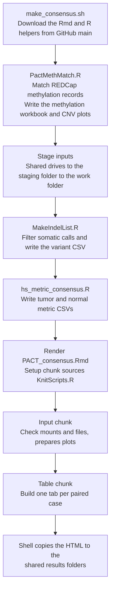

# PACT consensus report

`make_consensus.sh` generates `<PACT_ID>_consensus.html`. The report has one tab for each paired tumor–normal case. Each tab combines sequencing QC, somatic variant calls, copy-number (CNV) plots, tumor mutational burden and microsatellite instability (TMB/MSI), and methylation results.

## Usage

```bash
bash ~/make_consensus.sh RUN_ID PACT_ID [CONSENSUS_DIR] [KERBEROS_USER]
```

- **`RUN_ID`** is the sequencing run folder name, for example `123456_NB501073_0212_AHT3V7BGXK`. The shell sets `<YYYY>` to `20` plus the first two digits of `RUN_ID` (which is the year + date).
- **`PACT_ID`** is the PACT run name. Sophia IDs start with two digits, for example `26-PACT33`. Philips IDs use the form `PACT-YY-##`. The scripts use this pattern to select the Sophia or Philips code path.
- **`CONSENSUS_DIR`** is the parent of the work folder. The default is:
`/Volumes/CBioinformatics/jonathan/pact/consensus`
- **`KERBEROS_USER`** defaults to `$USER`. The shell passes it to the report as `userName`

`parsePact.sh` downloads `make_consensus.sh` to your Home folder and `printPactCommands.sh` prints the exact command for each run.

### Prerequisites

- A local Mac with R, `rmarkdown`, and Pandoc.
- Mounted shares: 
  - `/Volumes/molecular`
  - `/Volumes/CBioinformatics`
  - `/Volumes/snudem01labspace`.
- Network access to GitHub and the REDCap API
- The REDCap token file in `/Volumes/CBioinformatics`
- The methylation classifier R package `mnp.v12epicv2` installed

`KnitScripts.R` and `PactMethMatch.R` install Homebrew if it's missing, LaTeX, and missing R packages. `PactMethMatch.R` also writes a `PATH` line to `~/.Renviron`.

## Where the code comes from

Each run downloads the code from the `main` branch of `NYU-Molecular-Pathology/Methylation` on GitHub:

- The shell saves `PACT_consensus.Rmd` as `<PACT_ID>_consensus.Rmd` in the work folder.
- The shell saves `MakeIndelList.R`, `hs_metric_consensus.R`, and `PactMethMatch.R` to your Home folder and overwrites older copies.
- During rendering, the Rmd sources `KnitScripts.R` and reads `consensus.css` from GitHub.

## Folders

The rest of this README uses these names:

- **Work folder:** `<CONSENSUS_DIR>/<PACT_ID>_consensus/`
- **Staging folder:** `~/Desktop/<PACT_ID>/`
- **Shared results folder:** `/Volumes/molecular/MOLECULAR LAB ONLY/NYU PACT Patient Data/Results/Bioinformatics/<YYYY>/<PACT_ID>/`
- **NGS607 run folder:** `/Volumes/molecular/Molecular/NGS607/<YYYY>/<RUN_ID>/`
- **FACETS folder:** `/Volumes/molecular/Molecular/REDCap/cnv_facets/<PACT_ID>/`. FACETS is the tool that makes the NGS copy-number plots.
- **Methylation CNV folder:** `/Volumes/molecular/Molecular/MethylationClassifier/CNV_PNG/`

## Workflow overview



### How failures behave

- The shell runs with `set -Eeuo pipefail` and an `ERR` trap. Any failed command stops the run. The trap prints `ERR!`, the failed command, and the line number.
- The shell prints `Executing:` and the command before each step. The last `Executing:` block before `ERR!` identifies the failed step.
- The shell ignores a failure of `copy_marcin_idats.sh`.
- An error in the Rmd setup chunk stops rendering.
- The input and table chunks use the templates `input_opts` and `tab_opts`. Both set `error = TRUE`. An R error in these chunks does not stop rendering. The HTML still renders, and the shell reports success.
- The input chunk also sets `include = FALSE`. Its messages and errors do not appear in the HTML.

Always open the report after a run. Look for R error text and for missing case tabs.

## Inputs copied by `make_consensus.sh`

The shell copies the shared files to the staging folder first. Then it copies them to the work folder.

| Input | Source | Location in work folder |
| --- | --- | --- |
| FACETS PNGs | FACETS folder | `cnvpng/` and the work folder root. `MoveFacets()` later moves the root copies to `facet_pngs/`. |
| `<PACT_ID>-QC.tsv` | FACETS folder | Work folder root |
| `<PACT_ID>_Hotspots.tsv` | NGS607 run folder | Work folder root |
| `msi_validation.tsv` and `annotations.paired.tmb.validation.2callers.tsv` | `TMB_MSI/` in the shared results folder | `TMB_MSI/` |
| `demux-samplesheet.csv` | Shared results folder | Work folder root |
| `VAF_plots/`, when present | FACETS folder | `VAF_plots/` |
| `<PACT_ID>_MethylMatch.xlsx`, when present | `~/Desktop/`, written by `PactMethMatch.R` | Work folder root |

The staging-to-work copy uses `rsync --include=*.tsv` with no `--exclude`. It copies every file in the staging folder.

The scripts read these inputs directly from the shares. The shell does not copy them:

- `somatic_variants.csv` in the shared results folder (`MakeIndelList.R`)
- `samples.tumor.normal.csv` and `output/CollectHsMetrics/` in the NGS607 run folder (`hs_metric_consensus.R`)
- The HS metric CSVs, Philips data dumps, Sophia `cnv.tsv`, reference gene lists, methylation CNV PNGs, and methylation reports (`KnitScripts.R`)

## Script execution

1. **Download the report and helpers.** `make_consensus.sh` saves `PACT_consensus.Rmd` as `<PACT_ID>_consensus.Rmd` in the work folder. It downloads the three R helpers to your Home folder.
2. **Match methylation cases with `PactMethMatch.R <PACT_ID>`.** The shell runs it from your Home folder, so its working files go to your Home folder.
   - It reads sample identifiers. Philips runs use the `PhilipsExport` tab of `NYU PACT Patient Data/Workbook/<YYYY>/<PACT_ID>/<PACT_ID>.xlsm`. Sophia runs use `demux-samplesheet.csv` in the shared results folder.
   - It reads MRNs from the workbook tab named `Philips` (Philips runs) or `Beaker` (Sophia runs).
   - It exports the REDCap records with `RD-` record IDs. It matches each record that contains a sample identifier in any field. It appends each match to `~/Desktop/<PACT_ID>_match_log.tsv`.
   - It sets `report_complete` to `YES` when the REDCap `run_number` contains `MGDM`. Other matches get `NOT_YET_RUN`.
   - It builds `Report Link` and `Report Path` as SMB URLs. It attempts to repair broken report paths and lists the paths it cannot resolve.
   - It writes `~/Desktop/<PACT_ID>_MethylMatch.xlsx`. If no case matches, the workbook has one row of `NONE`.
   - For `YES` cases with no `<RD_NUMBER>_cnv.png` in the methylation CNV folder, it makes the plot. It writes `~/samplesheet.csv`, copies the IDATs (raw methylation array files) to your Home folder, and saves `~/Desktop/<RD_NUMBER>_cnv.png`. Then it copies the `_cnv.png` files made today to the methylation CNV folder.
3. **Stage the inputs.** The shell copies the files in the inputs table. It stops if `cnvpng/` is not writable. It runs `/Volumes/CBioinformatics/Bash_Scripts/copy_marcin_idats.sh` for GOS IDATs and continues if that helper fails.
4. **Prepare the variant table with `MakeIndelList.R <PACT_ID>`.**
   - It reads `Run_Number` from `demux-samplesheet.csv` to find the year folder.
   - It loads `somatic_variants.csv` from the shared results folder.
   - It drops Strelka-only calls (`Strelka` is `Yes`, `MuTect2` is `No`, and `LoFreqSomatic` is `No`).
   - It keeps one call per case and position. It prefers the MuTect2 call when calls overlap.
   - It adds a placeholder SNV row for each case with no calls and one CNV row for each case.
   - It writes `<PACT_ID>_desc.csv` in the work folder.
5. **Prepare sequencing metrics with `hs_metric_consensus.R <RUN_ID> <PACT_ID>`.**
   - It uses `samples.tumor.normal.csv` to sort the `*_hs_metrics.txt` files in `output/CollectHsMetrics/` into tumor and normal sets. The normal set includes the `SC_SERACARE` control.
   - It extracts `AT_DROPOUT`, `GC_DROPOUT`, `PCT_TARGET_BASES_250X`, `FOLD_80_BASE_PENALTY`, and `MEAN_TARGET_COVERAGE`.
   - It writes `<METRIC>_tumors_hs_metric_values.csv` and `<METRIC>_normals_hs_metric_values.csv`, with mean and SD rows, to `output/HS_Metrics_CSV/` in the NGS607 run folder.
6. **Render and copy the report.** The shell calls `rmarkdown::render()` with `pactName` and `userName`. It checks that the HTML exists and opens it. It copies the HTML to the staging folder and the shared results folder, then opens the shared results folder.

## How `PACT_consensus.Rmd` builds the report

Rendering (knitting) runs the R code in the Rmd and writes the HTML. The Rmd has three chunks.

1. **Setup chunk.** It sources `KnitScripts.R` from GitHub. `KnitScripts.R` installs missing tools and packages, defines the helper functions in the global environment as `gb`, loads `consensus.css`, and defines the chunk templates. The chunk builds the BAM link (`https://genome.med.nyu.edu/external/clinpathlab/<PACT_ID>`) and the QC link (`https://pactqc.nyumc.org/`).
2. **Input chunk (`input_opts`).**
   - `CheckMntDirs()` verifies `/Volumes/CBioinformatics/Methylation/` and `/Volumes/molecular/`. It sets the work folder as the working directory.
   - `CheckFiExist()` requires `demux-samplesheet.csv`, `<PACT_ID>-QC.tsv`, `<PACT_ID>_desc.csv`, and the `Philips_SFTP` directory. It requires `Philips_SFTP` for Sophia runs too. It logs a missing methylation workbook.
   - `CopyCnvPngs()` matches one FACETS PNG in `cnvpng/` to each tumor sample. It saves a copy named `<Test_Number>.png` (Sophia: `<TM_Number>.png`) in `ngs_cnv_png/`.
   - `MoveFacets()` moves the `*.FACETS.cnv.plot.png` files from the work folder root into `facet_pngs/`.
   - `GetMethCnv()` loads the `YES` rows of the methylation workbook and validates their report paths with `CheckMethPaths()`. It copies each `<RD_NUMBER>_cnv.png` into `methCNV/` from the methylation CNV folder. If the plot is not there, it uses the copy on the Desktop.
   - `CheckHotspots()` logs whether `<PACT_ID>_Hotspots.tsv` exists.
3. **Table chunk (`tab_opts`).** `LoopSampleTabs()` builds the case tabs.
   - It reads the sample sheet and keeps cases that have both a tumor and a normal row. Philips runs keep only `Test_Number` values that contain `NGS`.
   - Each tab shows the specimen ID, BAM path, QC, TMB/MSI, HS metrics, variants, and CNV. It adds methylation, hotspots, and VAF plots when available. It ends with the OncoKB Level 1 genes found in the variants.
   - Philips runs: it copies the newest `<Test_Number>_*` data dump from `Philips_SFTP` to `zipfiles/` and unzips it. It reads `aberration_snv.csv` and `aberration_cnv.csv`.
   - Sophia runs: it reads `cnv.tsv` from the shared results folder.
   - It reads the HS metric CSVs from the NGS607 folder of the `Run_Number` in `demux-samplesheet.csv`.
   - It reads `/Volumes/CBioinformatics/jonathan/pact/panel_607_genes.csv` and `/Volumes/CBioinformatics/jonathan/pact/OncoKB-Level1-Genes-Mar2026.xlsx`.
   - If REDCap `qc_passed` is `No`, the methylation tab is named `Methylation_QC_FAILED` and links to `<RD_NUMBER>_QC_FAILED.html`.

## Outputs

- **Final report:** `<PACT_ID>_consensus.html` in the work folder, with copies in the staging folder and the shared results folder. Open the shared copy to confirm it is viewable.
- **Work folder files:** the staged Rmd, the copied inputs, `<PACT_ID>_desc.csv`, and the plot folders `cnvpng/`, `ngs_cnv_png/`, `facet_pngs/`, and `methCNV/`. Philips runs also have `zipfiles/`.
- **Helper outputs:** the methylation workbook on the Desktop, new methylation CNV PNGs in the methylation CNV folder, and the HS metric CSVs in the NGS607 run folder.
- **Files in your Home folder:** `samplesheet.csv` and the copied IDATs from `PactMethMatch.R`. These files stay after the run.
- **Logs:** `~/Desktop/<PACT_ID>_match_log.tsv` gets new lines on each run. `~/missing_idats_log.csv`, `~/read_error_idat.txt`, and `~/missing_idat_files.txt` appear only when an IDAT problem occurs.

### Debug the report in RStudio

Run the chunks by hand to see the errors that the HTML hides.

1. Open `<PACT_ID>_consensus.Rmd` from the work folder in RStudio.
2. Define `params` in the top of the RMD file header:

   ```r
   pactName = "<PACT_ID>"
   userName = "<YOUR_NAME>"
   workDir = "/Volumes/CBioinformatics/jonathan/pact/consensus"
   ```

3. Run the "setup" chunk. To test a local `KnitScripts.R`, run `gb <- globalenv()` and then `source("KnitScripts.R")` from GitHub
4. Run the input chunk one line at a time. Errors and messages now appear in the console.
5. Run `gb$LoopSampleTabs(params)` to see errors from the table chunk.

## Troubleshooting

### The shell stops at `PactMethMatch.R`

Read the last lines before `ERR!`:

- **`file.exists(TOKEN_PATH) is not TRUE`:** The REDCap token file is not accessible. Mount `/Volumes/CBioinformatics`
- **`PACT run folder not found`:** Confirm that the Workbook or shared results folder name matches `PACT_ID`.
- **`Test Number not found in '<tab>' tab`:** Add the missing Test Number or just touch create a blank PNG or input file if for example one of the FACETS files did not generate.

### The shell stops at the PNG copy

The shell runs `cp "${DESK_DIR}/"*.png`. The command fails when the FACETS folder has no PNGs. Confirm that FACETS finished and that the FACETS folder contains the PNGs. Sometimes no PNG exists so look at the demux-samplesheet.csv and either skip the missing sample or create a blank png file with that name in the FACETS folder.

### The shell stops at `MakeIndelList.R` or `hs_metric_consensus.R`

- **`File not found: somatic_variants.csv`:** Confirm that `somatic_variants.csv` is in the shared results folder in the z-drive.
- **`dir.exists(csvPath) is not TRUE`:** The shared results folder does not exist under the year from `Run_Number` in `demux-samplesheet.csv`.
- **`No HS metrics for: <RUN_ID>`:** No folder in `/Volumes/molecular/Molecular/NGS607/<YYYY>/` matches `RUN_ID`.

### The report renders with R errors or no case tabs

An input check failed. The chunk templates let rendering continue. Common causes:

- A required file is missing from the work folder. `CheckFiExist()` lists the required files.
- The FACETS PNGs do not match the tumor samples. Look for `File png not found for sample` or `There are duplicated NGS numbers`.
- The sample sheet has 2 or fewer usable rows. Look for `nrow(samList) > 2 is not TRUE`.
- A methylation report path is broken. See the next section.

### Broken methylation report path

For rows with `report_complete = YES` in the MethylMatch.xlsx, `CheckMethPaths()` converts each nonempty `Report Path` from an SMB URL to a `/Volumes/...` path.
If the HTML file does not exist at that path, `LoopSampleTabs()` fails in the RMD. Expect the report to show `Paths don't exist:` with the missing paths, an R error, and no case tabs.

Restore the methylation HTML file to the expected location, or correct the **`Report Path`** cell in the workbook copy in the work folder. After a workbook edit, render again. Note just re-running make_consensus.sh again can regenerate the workbook and can overwrite the correction so if needed comment out the line for the Rscript call to PactMethMatch.R to avoid making a new xlsx file.

### The report says "No methylation sheet for this run!"

The work folder has no `<PACT_ID>_MethylMatch.xlsx`. For Sophia runs, `PactMethMatch.R` names the workbook from `Sample_Project` in `demux-samplesheet.csv`. If that value differs from `PACT_ID`, the shell does not copy the workbook. Rename the workbook to `<PACT_ID>_MethylMatch.xlsx`, copy it to the work folder, and render again.

### Missing IDATs or CNV plots

- **IDAT lookup fails.** When new methylation CNV plots are needed, `PactMethMatch.R` requires access to `/Volumes/molecular/MOLECULAR/iScan` and `/Volumes/snudem01labspace/idats`. 
- Check `~/missing_idats_log.csv`, `~/read_error_idat.txt`, or `~/missing_idat_files.txt`, if generated to see if any are missing.
- **A methylation CNV plot is missing.** Check the methylation CNV folder first. `PactMethMatch.R` skips plots already there. During rendering, `GetMethCnv()` checks the Desktop if the shared plot is missing.
- If neither location contains the PNG, `GetMethCnv()` fails with `PNG file not found` and the expected path.

### Unwritable consensus folder

If the shell stops at the `cnvpng/` permission check, verify write access to the existing `<PACT_ID>_consensus/` folder.
Another user can own the folder from an earlier run. If you need a fresh run folder, rename the existing one before you run the shell again.
